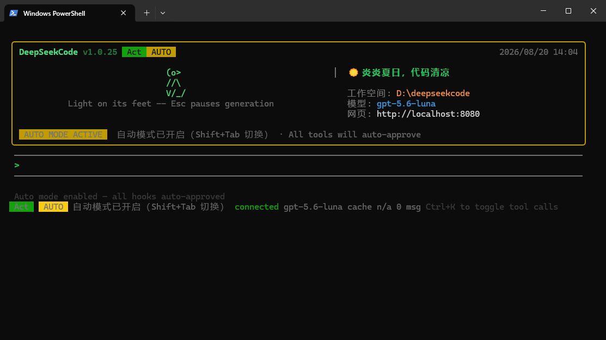
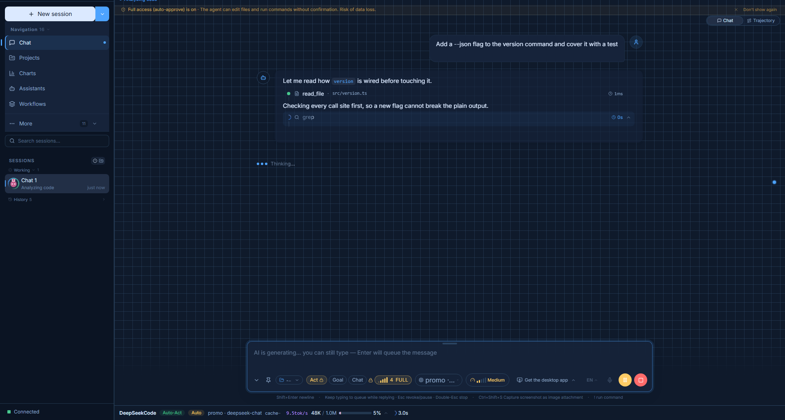

# DeepSeekCode

[English](README.md) · [简体中文](README.zh.md) · [日本語](README.ja.md) · [한국어](README.ko.md) · [Español](README.es.md) · [Français](README.fr.md) · [Deutsch](README.de.md) · [Português](README.pt.md) · [Русский](README.ru.md) · [Italiano](README.it.md) · [العربية](README.ar.md) · [Bahasa Indonesia](README.id.md)

**로컬 우선 AI 코딩 에이전트 — 로컬에서 도는 하나의 런타임이, 어떤 OpenAI 호환 모델로도 동작합니다.**

DeepSeekCode는 내 컴퓨터에서 실행되며, 동일한 에이전트 코어를 여러 진입점으로 제공합니다. 대화형 터미널 UI, `http://localhost:8080`의 웹 워크스페이스, HTTP/WebSocket API, 그리고 CI용 JSONL 배치 모드입니다. 모든 도구 호출은 사용자가 제어하는 권한 계층을 통과하며, UI는 12개 언어를 지원합니다.

이 저장소는 **공개 배포 지점**입니다. 다운로드 페이지(GitHub Pages)와 데스크톱 설치 파일을 제공합니다. 소스 저장소는 비공개입니다.

| | |
| --- | --- |
| 다운로드 페이지 | <https://deepseekcode.github.io/deepseekwork/> |
| 설치 파일 (Releases) | <https://github.com/deepseekcode/deepseekwork/releases> |
| npm 패키지 | <https://www.npmjs.com/package/@deepseekcode/cli> |
| 기계 판독용 요약 | <https://deepseekcode.github.io/deepseekwork/llms.txt> |



## 주요 특징

- **하나의 런타임, 여러 진입점** — 터미널 TUI, 웹 UI, HTTP + WebSocket API, 스크립트와 CI를 위한 `dscode exec` JSONL. 별도 백엔드를 설치할 필요가 없습니다.
- **모든 도구 호출에 권한 계층** — 스코프는 `system > project > user > local > session`(좁은 범위 우선), 정책은 `auto` / `ask` / `deny`, 회색 지대를 위한 선택적 AI 분류기, 타임아웃은 곧 거부입니다.
- **엄격한 읽기 전용 플랜 모드** — `/plan`은 체크리스트를 만들고, 승인하기 전에는 아무것도 실행하지 않습니다. 실행 시에는 엔진을 바꾸지 않고 동작 중인 루프가 그 체크리스트를 이어받습니다.
- **런타임 전환 모드** — `act`, `auto-act`, `goal`, `auto-goal`, `chat` (`Shift+Tab`으로 순환).
- **약 70개의 내장 도구** — 파일, 검색, git, LSP, 코드 인텔리전스, 브라우저, 서브 에이전트, 플랜, 메모리, MCP.
- **샌드박스 처리된 셸 도구** — Linux는 bwrap, macOS는 SBPL, Windows는 MXC / Docker. 사용할 수 있는 정책이 없으면 샌드박스 없는 호스트 셸로 내려가지 않고 실행 자체를 거부합니다.
- **확장 가능** — MCP 서버, 스킬, 플러그인, 서브 에이전트, 백그라운드 작업, 워크플로, 그리고 IM 채널(LINE, Slack, WhatsApp, QQ, DingTalk, Feishu). 인바운드 요청은 서명으로 검증됩니다.
- **지속성** — 세션을 넘어 유지되는 메모리와, 선택적으로 켜는 워치독. 사용자가 직접 멈춘 경우가 아닌 이유로 끊긴 실행을 이어서 완료합니다.
- **테마** — dark, light, nord, dracula, monokai, one-dark, tokyo-night.



## 설치

### npm (Node.js >= 18)

```bash
npm install -g @deepseekcode/cli
dscode
```

`dscode`와 `deepseekcode` 두 명령이 설치됩니다.

### 데스크톱 설치 파일

| 플랫폼 | 형식 |
| --- | --- |
| Windows x64 | `.exe`(NSIS), `.msi` |
| macOS (Apple Silicon + Intel) | 유니버설 `.dmg` |
| Linux x64 | `.deb`, `.rpm`, `.AppImage` |

[Releases](https://github.com/deepseekcode/deepseekwork/releases)에서 받으세요. 각 자산에는 같은 이름의 `.sig` 서명 파일이 함께 제공됩니다.

## 첫 실행

1. `dscode`를 실행합니다. 에이전트 코어와 HTTP/WebSocket 서버가 한 프로세스에서 함께 뜹니다.
2. `http://localhost:8080/#models`를 열고 OpenAI 호환 엔드포인트를 설정합니다. 해당 API를 말하는 서버라면 무엇이든 됩니다. `localhost`에서 도는 서버도 포함됩니다.
3. 터미널로 돌아와 작업을 설명합니다. 파일을 쓰거나 명령을 실행하는 동작은 모두 권한 계층을 거칩니다.

## 스크립트와 CI

```bash
dscode exec "fix the failing test in src/utils"   # 단일 작업, JSONL 출력
dscode exec --file ./task.txt --text              # 파일에서 작업 읽기, 일반 텍스트 출력
```

`exec`는 한 줄에 JSON 객체 하나를 출력하므로 프로그램에서 바로 소비할 수 있습니다. stdin이 TTY가 아니어도 비대화형 모드로 진입합니다.

## 이 저장소의 구성

| 경로 | 내용 |
| --- | --- |
| `website/` | 다운로드 페이지. 단일 정적 `index.html`이며 소스 저장소에서 동기화 |
| `website/llms.txt` | AI 크롤러용 기계 판독 요약(llmstxt.org 규약) |
| `website/zh/ ja/ ko/ es/ fr/` | 언어별 페이지 — **자동 생성, 직접 편집 금지** |
| `website/tools/gen-locales.mjs` | 언어별 페이지 생성기 |
| `website/sitemap.xml`, `website/robots.txt` | 크롤링 메타데이터 |
| `.github/workflows/pages-deploy.yml` | push 시 `website/`를 GitHub Pages로 배포 |
| `.github/workflows/release-stats.yml` | 매일 다운로드 수를 `.gh-stats/downloads.csv`에 기록 |
| `scripts/gh-download-stats.ps1` | 스냅샷 기록과 최근 증분 리포트(`-Report 7`) |
| `docs/` | i18n 설계 노트와 UI 스크린숏 소재 |
| `_promo/` | 홍보 소재 녹화 도구 체인 |

## 이 저장소의 운영 방식

**새 버전 배포 — 코드 수정 불필요**

1. 소스 저장소에서 `desktop-v*` 태그를 만들면 `desktop-release` 워크플로가 세 플랫폼 설치 파일을 빌드해 이 저장소의 Releases에 업로드합니다.
2. 페이지는 로드 시 GitHub `/releases/latest`에서 최신 `desktop-v*` 태그를 조회합니다. 버전 배지, 다운로드 링크, Release 링크가 모두 자동으로 따라갑니다.

`CONFIG.version` / `CONFIG.cliVersion`은 폴백일 뿐이며, GitHub API 속도 제한이나 네트워크 단절 시에만 사용됩니다.

**페이지 자체 수정(문구, 레이아웃, 구조)**

1. 소스 저장소의 `website/index.html`을 수정합니다. 문구는 `EN` / `OV` 사전에 있습니다. 페이지의 정적 텍스트 58곳은 미리 렌더링된 스냅숏이며, `render()`가 브라우저에서 같은 사전으로 덮어쓰므로 둘이 어긋나지 않습니다.
2. 문구를 바꿨다면 언어별 페이지를 다시 생성합니다: `node website/tools/gen-locales.mjs`(같은 i18n 사전을 재사용하며, 번역이 없는 키는 영어로 대체).
3. 최신 `website/`를 이 저장소에 동기화하고 push → GitHub Pages가 자동 갱신됩니다.

**다운로드 통계** — GitHub은 자산별 **누적** `download_count`만 제공하므로, `release-stats.yml`이 하루 한 번 그 누적값을 `.gh-stats/downloads.csv`에 기록합니다. "최근 N일 신규 다운로드"는 이 시계열에서 `powershell -File scripts\gh-download-stats.ps1 -Report 7`로 계산합니다.

**GitHub Pages 최초 설정** — Settings → Pages → Source에서 **GitHub Actions**를 선택합니다. 배포는 워크플로가 담당하므로 브랜치나 폴더를 고를 필요가 없습니다.

## 언어

제품 UI는 12개 언어를 지원하고, 다운로드 페이지는 6개 언어를 배포합니다. 언어마다 고유한 정적 URL이 있어 JavaScript를 실행하지 않는 크롤러도 해당 언어 콘텐츠를 읽을 수 있습니다.

| 언어 | URL |
| --- | --- |
| English(기본) | <https://deepseekcode.github.io/deepseekwork/> |
| 简体中文 | <https://deepseekcode.github.io/deepseekwork/zh/> |
| 日本語 | <https://deepseekcode.github.io/deepseekwork/ja/> |
| 한국어 | <https://deepseekcode.github.io/deepseekwork/ko/> |
| Español | <https://deepseekcode.github.io/deepseekwork/es/> |
| Français | <https://deepseekcode.github.io/deepseekwork/fr/> |

## 라이선스

독점 소프트웨어이며 클로즈드 소스입니다. **오픈 소스가 아닙니다.** 복제, 수정, 배포, 재실시, 판매에는 저작권자의 사전 서면 허가가 필요합니다. © 2026 DeepSeekCode. All rights reserved.

DeepSeekCode는 독립 프로젝트입니다. DeepSeek(深度求索)이나 다른 어떤 모델·도구 벤더와도 제휴, 후원, 보증 관계가 없습니다. 이름은 클라이언트 런타임을 가리키며 모델 계열을 뜻하지 않습니다. 제품은 자체 모델을 포함하지 않고, 사용자가 설정한 OpenAI 호환 엔드포인트를 구동할 뿐입니다.
